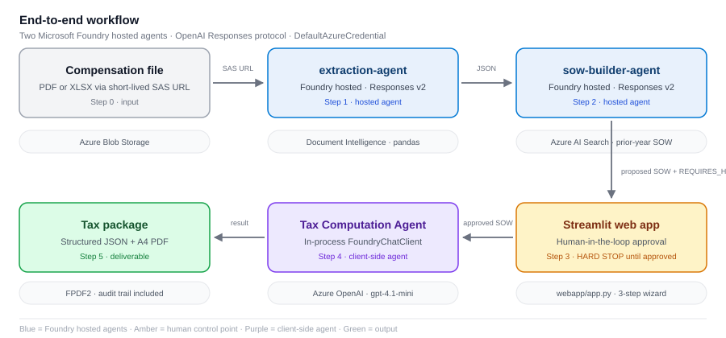
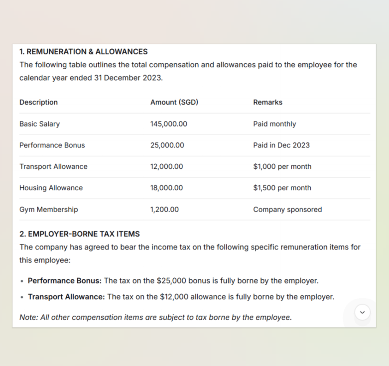
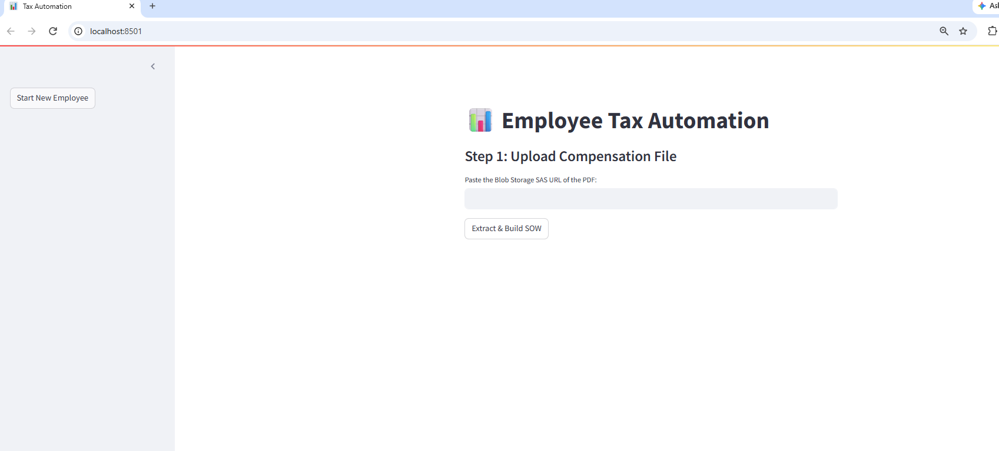
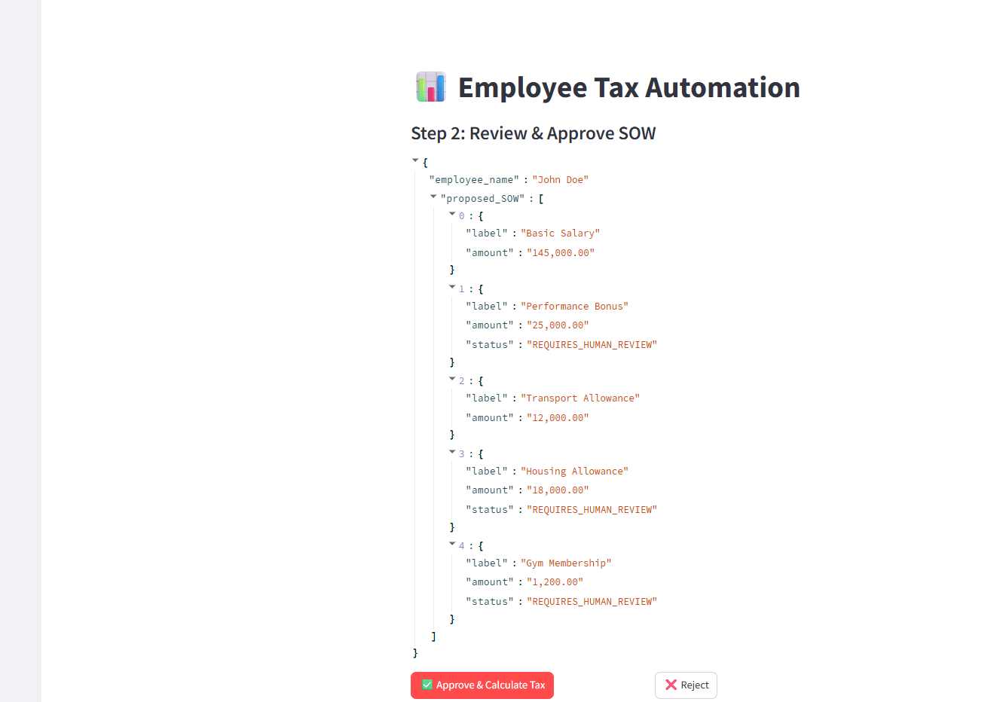
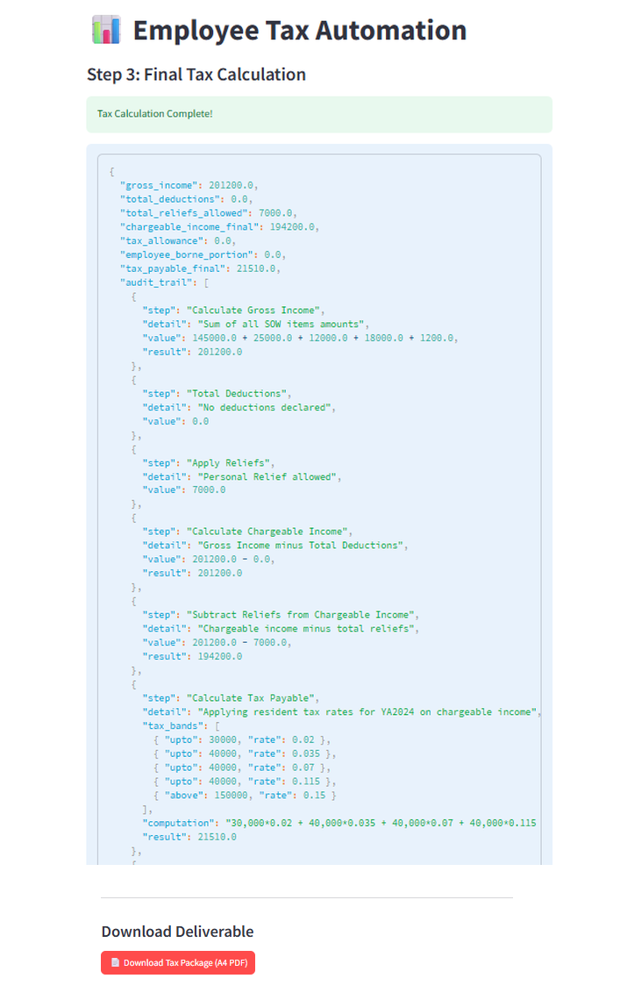
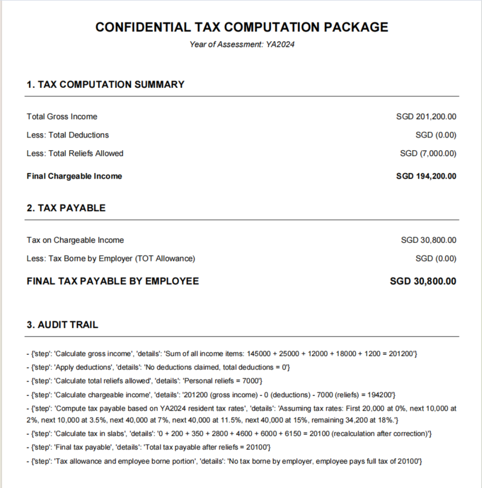
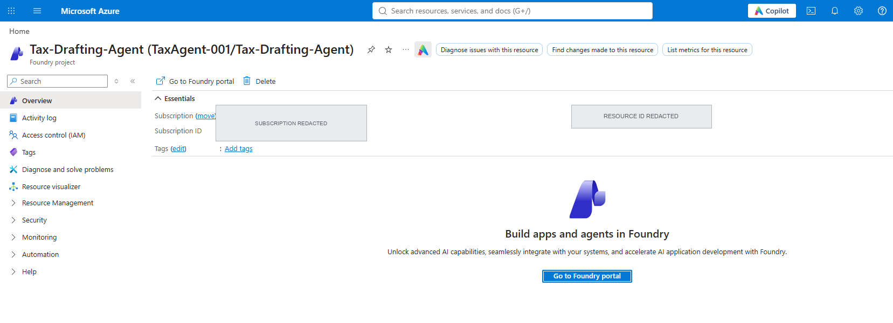
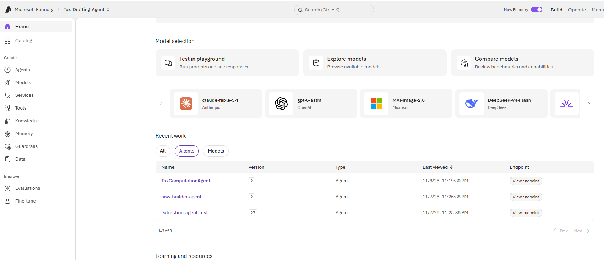
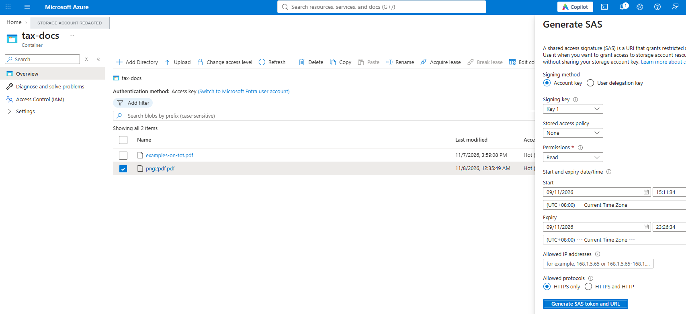

# Foundry Tax Automation

**Two Microsoft Foundry hosted agents + a human-in-the-loop Streamlit app that turns a compensation document into a reviewed tax computation package.**

[](https://www.python.org/)
[](https://learn.microsoft.com/en-us/azure/foundry/agents/concepts/hosted-agents)
[](LICENSE)
[](CONTRIBUTING.md)

> **Project status: working prototype / portfolio project.**
> This repository is a cleaned, self-contained version of a side project. The
> prior-year lookup has a demo-data fallback and the tax rules are a template,
> not tax advice. See [Known limitations](docs/known-limitations.md) before
> using it with real data.

---

## What it does

1. **Extract** — the `extraction-agent` reads a PDF or XLSX from a short-lived
   Blob Storage SAS URL. PDFs go through Azure Document Intelligence
   (`prebuilt-layout`); spreadsheets go through pandas. It returns the employee
   name and their compensation line items as JSON.
2. **Build the SOW** — the `sow-builder-agent` looks up the employee's
   prior-year Schedule of Work, compares it with the current-year items, and
   marks anything new as `REQUIRES_HUMAN_REVIEW`.
3. **Human approval** — a Streamlit app shows the proposed SOW. **No tax is
   computed until a person explicitly approves it.**
4. **Compute & deliver** — a tax-computation agent produces a structured
   result, which the app renders as JSON and as a downloadable A4 PDF.

Both agents use the [Microsoft Agent Framework](https://github.com/microsoft/agent-framework)
and are served over the **OpenAI Responses protocol** by
`ResponsesHostServer`. They are containerized and hosted by
[Foundry Agent Service](https://learn.microsoft.com/en-us/azure/foundry/agents/concepts/hosted-agents),
so Azure handles hosting, scaling and observability.

---

## Architecture at a glance



<details>
<summary>Text version</summary>

```
[PDF / XLSX in Blob Storage]
        |  SAS URL
        v
[extraction-agent]  --- Azure Document Intelligence / pandas
        |  { employee_name, compensation_items[] }
        v
[sow-builder-agent] --- Azure AI Search (prior-year SOW)
        |  proposed SOW + REQUIRES_HUMAN_REVIEW
        v
[Streamlit app: human approval]   <-- hard stop here until approved
        |
        v
[Tax Computation Agent] --- Azure OpenAI gpt-4.1-mini
        |
        v
[JSON result + A4 PDF package]
```

</details>

Full detail, data contracts and sequence diagram: [docs/architecture.md](docs/architecture.md).

---

## 🖼️ Demo & screenshots

Every figure below uses **synthetic sample data** (`John Doe`, demo SGD
amounts). Azure subscription IDs, storage-account names and SAS tokens were
redacted before publishing — see the
[Screenshot shot list](docs/screenshots.md) for the capture and redaction rules.

### The input document

A one-page remuneration & allowances PDF is uploaded to Blob Storage and read
through a short-lived read-only SAS URL. It contains no real employee data.



### Step 1 — upload a compensation document



### Step 2 — review and approve the proposed SOW



Items absent from the prior-year Schedule of Work are marked
`REQUIRES_HUMAN_REVIEW`. **Nothing is computed until a person approves.**

### Step 3 — result and PDF deliverable



### The generated tax package



<details>
<summary>Azure-side evidence — project, agents and SAS configuration</summary>

**The Microsoft Foundry project** (subscription name, subscription ID and parent
resource ID redacted).



**Both hosted agents registered in the project.** The third entry is the
in-process tax-computation agent used after human approval.



**Generating a short-lived read-only SAS URL.** The generated *Blob SAS token*
and *Blob SAS URL* fields are deliberately excluded from the capture — those
values are credentials and must never be published.



</details>

---

## Repository layout

| Path | What it is |
| --- | --- |
| `agents/extraction-agent/` | Hosted agent #1 — PDF/XLSX → compensation JSON. Includes its own `azure.yaml` and Dockerfile. |
| `agents/sow-builder-agent/` | Hosted agent #2 — prior-year comparison → proposed SOW JSON. Includes its own `azure.yaml` and Dockerfile. |
| `webapp/app.py` | **The Streamlit web app** — 3-step human-in-the-loop UI and PDF download. |
| `webapp/orchestrator.py` | CLI version of the same workflow, useful for debugging. |
| `webapp/common.py` | Shared agent calls, JSON normalization, tax input builder, PDF renderer. |
| `webapp/tax_agent.md` | Tax-computation system prompt **template** (replace with your own reviewed rules). |
| `docs/` | Full documentation set and the screenshot folder. |
| `.env.example` | Every configuration variable, with placeholders only. |

Each agent directory is an independent [Azure Developer CLI](https://learn.microsoft.com/en-us/azure/developer/azure-developer-cli/overview)
app and is deployed separately from its own folder.

---

## Quick start

> Prerequisites: Python 3.13+, an Azure subscription, [Azure CLI](https://learn.microsoft.com/en-us/cli/azure/install-azure-cli),
> and [azd](https://learn.microsoft.com/en-us/azure/developer/azure-developer-cli/install-azd).

```bash
# 1. Clone
git clone https://github.com/Junyao95/foundry-tax-automation.git
cd foundry-tax-automation

# 2. Configure (copy, then fill in your own resource URLs and keys)
cp .env.example .env

# 3. Sign in
az login
azd auth login

# 4. Deploy both hosted agents (from their own directories)
cd agents/extraction-agent && azd up && cd ../..
cd agents/sow-builder-agent && azd up && cd ../..

# 5. Install the web app dependencies and run it
python -m venv .venv
source .venv/Scripts/activate      # Windows Git Bash; use .venv\Scripts\activate on CMD
pip install -r webapp/requirements.txt
streamlit run webapp/app.py
```

The full walkthrough — including creating the Azure resources, finding the two
agent endpoint URLs, setting up the AI Search index, and tearing everything
down — is in [docs/deployment.md](docs/deployment.md).

---

## Documentation

| Document | Contents |
| --- | --- |
| [Architecture](docs/architecture.md) | Component diagram, sequence diagram, data contracts, design decisions, Azure resource inventory. |
| [Deployment](docs/deployment.md) | End-to-end Azure setup, `azd up` for both agents, endpoint discovery, verification, teardown, cost notes. |
| [API reference](docs/api.md) | Responses-protocol request/response shape, both agent contracts, tool signatures, curl and Python examples. |
| [Configuration](docs/configuration.md) | Every environment variable, which component needs it, and secret-handling guidance. |
| [Development](docs/development.md) | Local setup, running agents locally, debugging, adding a tool, test checklist. |
| [Troubleshooting](docs/troubleshooting.md) | Symptom → cause → fix for the common failure modes. |
| [Known limitations](docs/known-limitations.md) | Honest list of what is demo-grade and what is not. |
| [Screenshot shot list](docs/screenshots.md) | Every screenshot slot, capture instructions, redaction rules, embed snippets. |

---

## Tech stack

| Layer | Technology |
| --- | --- |
| Agent runtime | Microsoft Agent Framework, `ResponsesHostServer`, OpenAI Responses protocol v2 |
| Hosting | Microsoft Foundry Agent Service (`azd`, `microsoft.foundry` infra provider) |
| Model | Azure OpenAI `gpt-4.1-mini` (GlobalStandard) |
| Document extraction | Azure Document Intelligence `prebuilt-layout`, pandas + openpyxl |
| Prior-year lookup | Azure AI Search (with a labelled demo fallback) |
| Auth | `DefaultAzureCredential` — Azure CLI locally, managed identity on Azure |
| Front end | Streamlit, FPDF2, httpx |
| Containers | Python 3.13-slim, 0.5 vCPU / 1 GiB, port 8088 |

---

## Security

This repository contains **no credentials, tokens, tenant IDs or
tenant-specific resource URLs**. All deployment-specific values come from
environment variables (`.env`, gitignored) and authentication uses
`DefaultAzureCredential`. The showcase screenshots were redacted before
committing: subscription names/IDs, storage-account names and every SAS token
or SAS URL field were removed. See [SECURITY.md](SECURITY.md) for the reporting
policy and [docs/configuration.md](docs/configuration.md#4-secret-handling) for
how to wire Key Vault and managed identity in production.

> If you are the original author of the working copy this was derived from:
> **rotate the Document Intelligence key and the Azure AI Search admin key**
> that existed in the old `azure.yaml` files. They were plaintext and should be
> treated as exposed. See [docs/deployment.md#2-rotate-exposed-keys](docs/deployment.md#2-rotate-exposed-keys).

---

## Contributing & license

Issues and pull requests are welcome — see [CONTRIBUTING.md](CONTRIBUTING.md).
Released under the [MIT License](LICENSE).

Built on top of the [Microsoft Foundry hosted agent samples](https://github.com/microsoft-foundry/foundry-samples).
Thanks to the Agent Framework and Foundry teams for the reference implementation.
