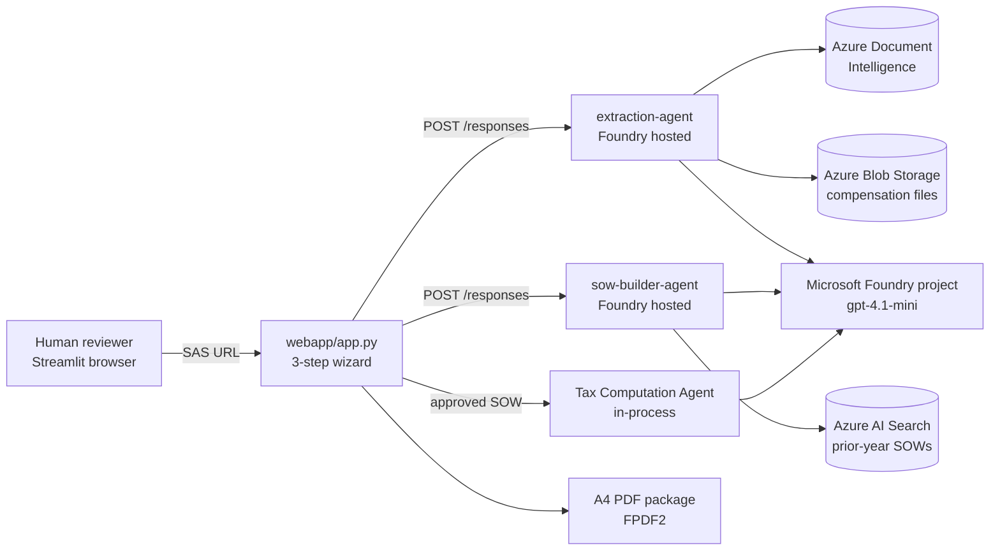
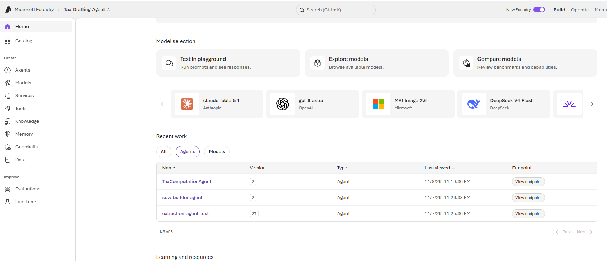
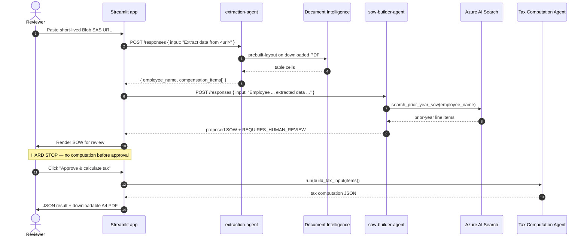
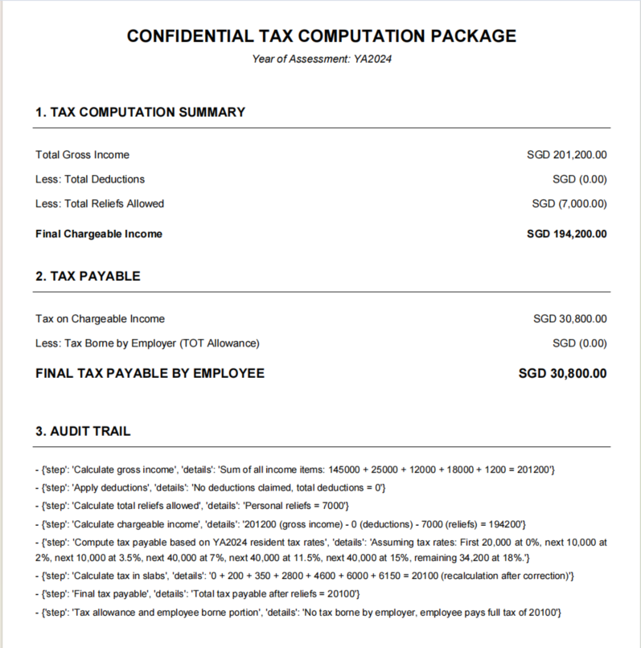

# Architecture

This document describes how the pieces fit together, the exact data passed
between them, and why the workflow is shaped this way. For a one-glance picture
see [architecture.svg](architecture.svg) in the README.

---

## 1. System context



Two agents are **hosted** by Foundry Agent Service (containerized, scaled and
observed by Azure). The tax-computation agent is **not** deployed separately —
it is an `Agent` object constructed inside the web app process using
`FoundryChatClient`. This is a deliberate asymmetry: the hosted agents are
reusable document-processing steps; the tax step depends on a private,
jurisdiction-specific prompt and runs only after a human signs off.

Both hosted agents registered in the Foundry project:



---

## 2. End-to-end sequence



If the reviewer clicks **Reject**, the flow returns to step 1 and nothing is
computed. The same gate exists in the CLI
([`webapp/orchestrator.py`](../webapp/orchestrator.py)).

---

## 3. Components

| Component | Location | Responsibility | Runs where |
| --- | --- | --- | --- |
| `extraction-agent` | `agents/extraction-agent/src/main.py` | Downloads PDF/XLSX from a SAS URL, extracts text, returns normalized compensation JSON. | Foundry hosted container |
| `sow-builder-agent` | `agents/sow-builder-agent/src/main.py` | Looks up the prior-year SOW, compares line items, flags new ones for review, emits a proposed SOW. | Foundry hosted container |
| Streamlit UI | `webapp/app.py` | 3-step wizard, human approval gate, result rendering, PDF download. | Local / App Service / Container Apps |
| CLI orchestrator | `webapp/orchestrator.py` | Same flow in a terminal, for debugging. | Local |
| Shared helpers | `webapp/common.py` | Agent invocation, JSON cleanup, SOW normalization, tax input builder, PDF rendering. | Client process |
| Tax computation | `webapp/common.py` + `webapp/tax_agent.md` | In-process `Agent` using `FoundryChatClient`. | Client process |

### Agent tools

**`extraction-agent`** exposes two Python functions as Agent Framework tools:

| Tool | Input | Behaviour |
| --- | --- | --- |
| `extract_from_pdf(file_url)` | URL string | Downloads the PDF, calls Document Intelligence `prebuilt-layout`, returns every table cell's text as `extracted_text[]`. |
| `extract_from_excel(file_url)` | URL string | Downloads the XLSX, reads it with pandas, returns rows as JSON records. |

Both return `{"status": "error", "message": "..."}` on failure rather than
raising, so the model can explain the problem instead of inventing data.
Temporary files are always deleted in a `finally` block.

**`sow-builder-agent`** exposes one tool:

| Tool | Input | Behaviour |
| --- | --- | --- |
| `search_prior_year_sow(employee_name)` | Employee name | Queries the `prior-year-sows` Azure AI Search index. If credentials are absent, returns clearly labelled `_source: "demo-data"` fixtures. |

---

## 4. Data contracts

### 4.1 Extraction Agent output

Produced by the agent's system instructions, not by a fixed schema validator.

```json
{
  "employee_name": "Jane Tan",
  "compensation_items": [
    { "label": "Basic Salary", "amount": 145000 },
    { "label": "Transport Allowance", "amount": 12000 },
    { "label": "Gym Membership", "amount": 1200 }
  ]
}
```

### 4.2 SOW Builder Agent output

```json
{
  "employee_name": "Jane Tan",
  "proposed_SOW": [
    { "Description": "Basic Salary", "Amount (SGD)": "145,000", "status": "MATCHED" },
    { "Description": "Gym Membership", "Amount (SGD)": "1,200", "status": "REQUIRES_HUMAN_REVIEW" }
  ],
  "notes": "1 item was not present in the prior-year SOW."
}
```

The exact key names are model-generated, which is why
`parse_sow_items()` accepts both `Description` / `Amount (SGD)` and
`label` / `amount`, and strips Markdown fences and stray prose before parsing.

### 4.3 Tax Computation Agent input

```json
{
  "sow_items": [
    { "label": "Basic Salary", "amount": 145000.0,
      "employer": "Example Employer Pte Ltd", "tax_borne_by_employer": false }
  ],
  "tot_method": "none",
  "deductions": [],
  "reliefs": [{ "label": "Personal Reliefs", "amount": 7000 }],
  "tax_year": "YA2024",
  "residency": "resident"
}
```

### 4.4 Tax Computation Agent output

```json
{
  "gross_income": 0,
  "total_deductions": 0,
  "total_reliefs_allowed": 0,
  "chargeable_income_final": 0,
  "tax_payable_final": 0,
  "tax_allowance": 0,
  "employee_borne_portion": 0,
  "audit_trail": ["..."]
}
```

This object drives both the JSON view in the UI and the A4 PDF. Rendered
deliverable (synthetic demo figures):



---

## 5. Azure resource inventory

| Resource | Used by | Purpose |
| --- | --- | --- |
| Microsoft Foundry project (AI Foundry / `services.ai.azure.com`) | All agents | Hosts agents and the model deployment. |
| Azure OpenAI `gpt-4.1-mini`, GlobalStandard, capacity 10 | All agents | Reasoning for extraction, comparison and tax computation. |
| Foundry Agent Service (hosted agents) | Two hosted agents | Builds/runs the containers; 0.5 vCPU / 1 GiB each; port 8088. |
| Azure Document Intelligence | `extraction-agent` | `prebuilt-layout` OCR/table extraction from PDFs. |
| Azure AI Search | `sow-builder-agent` | Prior-year SOW index `prior-year-sows`. Optional in demo mode. |
| Azure Blob Storage | Input documents | Stores compensation files; accessed with short-lived read-only SAS URLs. |
| Azure Key Vault *(recommended, not wired here)* | All | Store the two service keys instead of injecting raw values. |
| Entra ID / `DefaultAzureCredential` | All | `az login` locally, managed identity on Azure. |

---

## 6. Design decisions

**Why a human-in-the-loop gate?** Tax treatment of a new compensation item is a
judgement call with real financial consequences. The system flags novel items
rather than silently including or dropping them, and requires an explicit
approval click before any computation runs. This is the core safety property of
the project.

**Why the Responses protocol?** `ResponsesHostServer` exposes an
OpenAI-compatible REST surface, so each agent can be invoked with a simple
`POST {"input": ...}` and tested independently with `azd ai agent invoke` or
curl. The clients do not need the Agent Framework SDK to call the hosted
agents — only `httpx` and an Entra token.

**Why `store: False`?** Both hosted agents are stateless document processors.
There is no conversation memory to manage or leak between employees, and each
request is self-contained.

**Why two separate `azd` apps?** Each agent directory has its own `azure.yaml`
and Dockerfile, so agents can be versioned, deployed and rolled back
independently. Point both at the same `FOUNDRY_PROJECT_ENDPOINT` to share one
project and model deployment.

**Why `DefaultAzureCredential` everywhere?** It removes long-lived secrets from
the codebase entirely. Locally it uses `az login`; on Azure it uses a managed
identity. The two remaining service keys (Document Intelligence, AI Search)
are injected as environment variables at deploy time and should move to Key
Vault for production — see [configuration.md](configuration.md#4-secret-handling).

**Why conservative flagging?** The SOW Builder is instructed to flag an item as
`REQUIRES_HUMAN_REVIEW` when it is absent from the prior year, and to report a
failed lookup rather than fabricate a prior-year baseline. A false alarm is
cheap; a silently misclassified allowance is not.

---

## 7. Failure behaviour

| Failure | What happens |
| --- | --- |
| Document Intelligence credentials missing | Tool returns a structured error; the agent explains it instead of inventing data. |
| SAS URL expired / file unreachable | Download raises; tool returns `status: error`. |
| AI Search unavailable | `search_prior_year_sow` returns `status: error`; the SOW Builder is instructed not to emit a proposed SOW. |
| SOW JSON unparseable | `parse_sow_items()` raises; the UI falls back to labelled demo data **only** when `DEMO_FALLBACK=true`. The CLI always fails loudly. |
| Reviewer rejects | Flow resets to step 1; no tax computation and no output file. |
| Tax agent returns invalid JSON | `generate_tax_pdf()` renders an error PDF containing the raw response. |

See [troubleshooting.md](troubleshooting.md) for concrete fixes.
