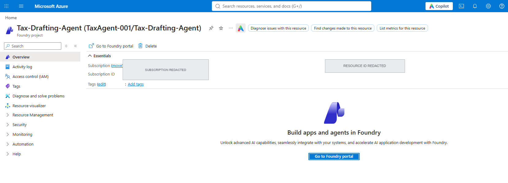
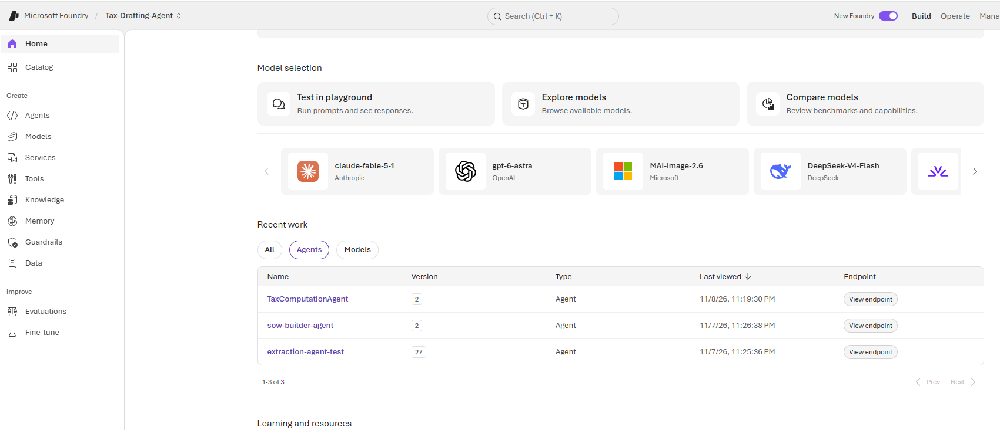
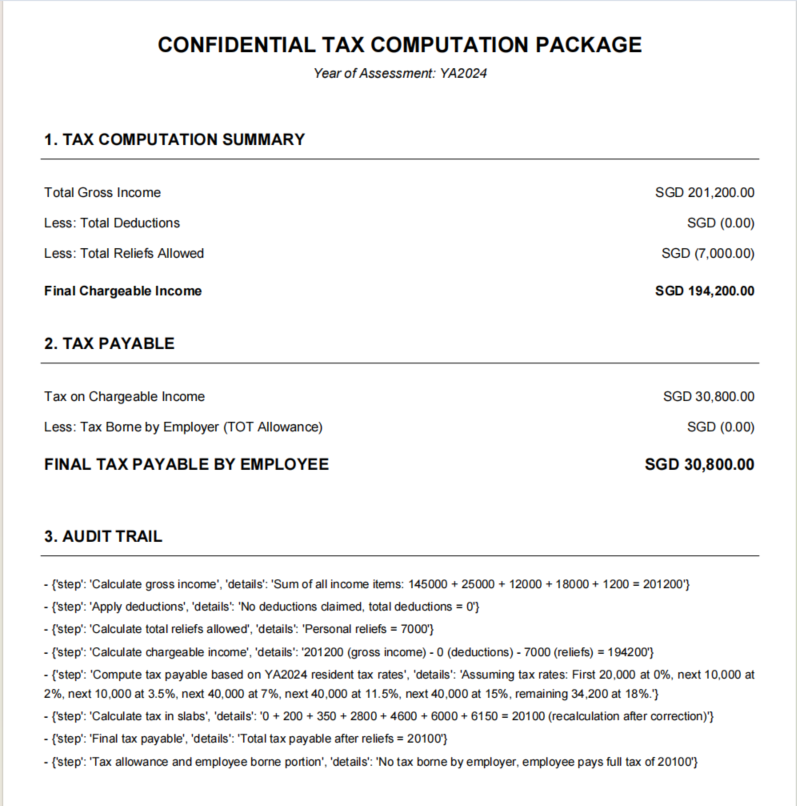

# Screenshot shot list

**Status: not captured yet.** Every place a screenshot belongs is already
marked in the docs with a `📸 SLOT` callout, so filling them in is a
copy-paste job — no restructuring needed.

- Folder: [`docs/screenshots/`](screenshots/)
- The `` snippets below are **relative to the file named in "Embed in"**.
  For `README.md` they start with `docs/screenshots/`; for files inside `docs/`
  they start with `screenshots/`.
- Format: PNG, ~1440 px wide, 1× or 2×, cropped to the relevant window
- Filenames: exactly as listed below (lowercase, hyphens, numbered)
- Commit them to `docs/screenshots/` and replace the matching callout block

---

## Redaction rules (read before capturing)

A portfolio screenshot can leak more than a README ever will. Before publishing,
blur or crop out:

- Subscription IDs, tenant IDs, resource group names and full resource URLs
- Email addresses, employee names (use `Jane Tan` / `John Doe` sample data)
- **SAS query strings** (`?sv=...&sig=...`) — click into the URL field and
  select a fake URL before capturing, or blur the field entirely
- API keys, tokens, client secrets and connection strings
- Browser profile pictures, notification toasts and bookmarks bar
- Anything from a real employer or a real compensation document

Run `git diff --cached` / inspect the final PNG at 100% zoom before committing.

---

## Slots

### Slot 01 — `01-portal-project.png`

| | |
| --- | --- |
| **Capture** | Azure Portal → your Microsoft Foundry project → Overview |
| **Show** | The project name, model deployment and the fact that two agents live in it |
| **Embed in** | `docs/deployment.md` after step 7; optionally `README.md` |
| **Redact** | Subscription ID, tenant ID, account name, email in the top-right |

```markdown

```

### Slot 02 — `02-hosted-agents.png`

| | |
| --- | --- |
| **Capture** | Foundry project → Agents list showing `extraction-agent` and `sow-builder-agent` |
| **Show** | Both agents deployed and healthy — the clearest proof of the architecture |
| **Embed in** | `README.md` under "Architecture at a glance"; `docs/architecture.md` §1 |
| **Redact** | Resource IDs, subscription/tenant IDs |

```markdown

```

### Slot 03 — `03-terminal-invoke.png`

| | |
| --- | --- |
| **Capture** | Terminal showing `azd ai agent invoke --local "Extract data from: ..."` and its JSON response |
| **Show** | That each agent is independently testable over the Responses protocol |
| **Embed in** | `docs/development.md` §2; `docs/api.md` §3 |
| **Redact** | Any SAS URL in the command, tokens, absolute home-directory paths if desired |

```markdown

```

### Slot 04 — `04-upload.png`

| | |
| --- | --- |
| **Capture** | Streamlit Step 1 — "Upload compensation file", SAS URL field, "Extract & build SOW" button |
| **Show** | The entry point of the app and the SAS-URL safety caption |
| **Embed in** | `README.md` → "Demo & screenshots" (first slot) |
| **Redact** | **The SAS URL** — use a fake `https://example.blob.core.windows.net/compensation/sample.pdf?...` value |

```markdown

```

### Slot 05 — `05-sow-review.png`

| | |
| --- | --- |
| **Capture** | Streamlit Step 2 — proposed SOW in `st.json` with the amber "flagged for human review" warning and Approve / Reject buttons |
| **Show** | **The most important screenshot**: the human-in-the-loop control point |
| **Embed in** | `README.md` → "Demo & screenshots" (middle slot); `docs/architecture.md` §2 |
| **Redact** | Employee name (use sample data), any real amounts if sensitive |

```markdown

```

### Slot 06 — `06-result-pdf.png`

| | |
| --- | --- |
| **Capture** | Streamlit Step 3 — tax computation JSON and the "Download tax package (A4 PDF)" button |
| **Show** | A completed end-to-end run and the deliverable |
| **Embed in** | `README.md` → "Demo & screenshots" (third slot) |
| **Redact** | Employee name, real figures if sensitive |

```markdown

```

### Slot 07 — `07-pdf-package.png`

| | |
| --- | --- |
| **Capture** | The generated `Tax_Package_*.pdf` opened in a PDF viewer |
| **Show** | Sections 1–3: summary, tax payable, audit trail |
| **Embed in** | `docs/architecture.md` §4.4; `README.md` if there is room |
| **Redact** | Employee name, real figures |

```markdown

```

### Slot 08 — `08-logs-traces.png` *(optional)*

| | |
| --- | --- |
| **Capture** | Foundry Agent Service logs / tracing view for one invocation |
| **Show** | Azure-side observability |
| **Embed in** | `docs/deployment.md` §11 (smoke test) |
| **Redact** | Request IDs that contain tenant info, full endpoint URLs, user email |

```markdown

```

### Slot 09 — `09-cli-orchestrator.png` *(optional)*

| | |
| --- | --- |
| **Capture** | `python webapp/orchestrator.py` showing the `[1/3]`, `[2/3]`, approval prompt and final result |
| **Show** | The CLI alternative and the terminal approval gate |
| **Embed in** | `docs/development.md` §3 |
| **Redact** | SAS URL, absolute paths, employee name |

```markdown

```

---

## Ready-to-paste README block

Once slots 04–06 exist, replace the three `📸 SLOT` callouts in `README.md`
with:

```markdown
## 🖼️ Demo

### Upload a compensation document


### Review and approve the proposed SOW


The amber warning marks items absent from the prior year as
`REQUIRES_HUMAN_REVIEW`. Nothing is computed until a person approves.

### Result and PDF deliverable

```

---

## Quick checklist

- [ ] All PNGs named exactly as above and placed in `docs/screenshots/`
- [ ] No SAS URLs, keys, tenant/subscription IDs or real employee data visible
- [ ] Callout blocks replaced with the `` snippets
- [ ] Images render in GitHub's Markdown preview (relative paths)
- [ ] Large PNGs compressed (aim for < 500 KB each) so the repo stays light
- [ ] `docs/screenshots/README.md` still accurate
